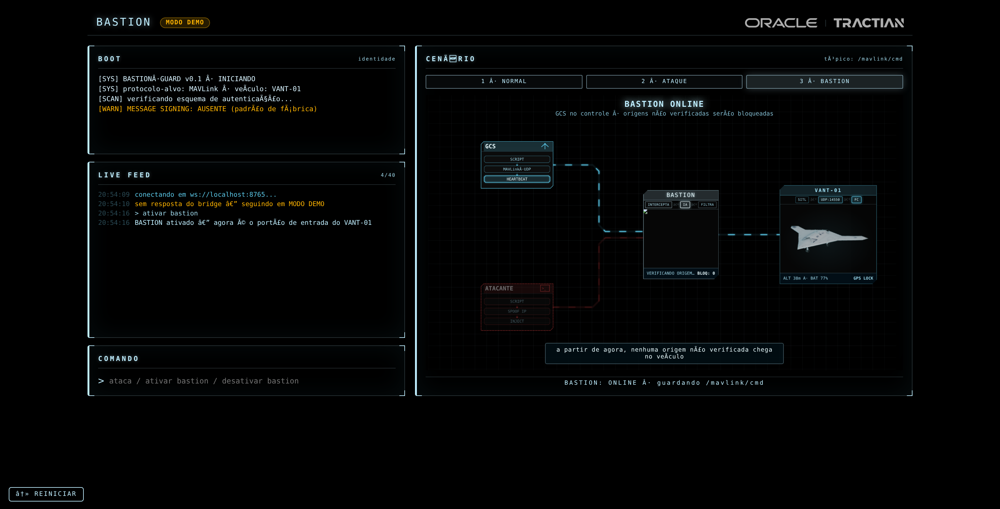

# BASTION

**Firewall de IA entre a estação de controle (GCS) e um VANT — protocolo MAVLink, sem assinatura de mensagem por padrão.**

Demo ao vivo no talk sobre segurança em drones no **[AI Tinkerers São Paulo](https://aitinkerers.org/)**, 26/11/2026.

---

Qualquer origem não autenticada consegue falar com o canal `/mavlink/cmd` de um veículo que usa o protocolo MAVLink sem message signing — o padrão de fábrica da maioria dos controladores de voo. O Bastion intercepta, analisa e filtra esse tráfego antes que ele chegue ao veículo.

A demo completa — ataque, sequestro de controle e bloqueio em tempo real — roda ao vivo na talk.
